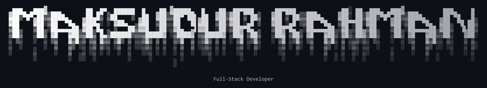

<h1 align="center">Hey  I'm </h1>

  

  

## <h2 align="center">👨‍💻 About Me</h2>

I'm a Full-Stack Web Developer passionate about building modern, responsive, and user-friendly web applications. I enjoy exploring new technologies, solving problems, and turning ideas into practical solutions. Currently, I'm deepening my knowledge of TypeScript, Next.js, and backend development while building real-world projects.

---

## <h2 align="center">🛠️ Tech Stack</h2>

<table align="center">
  <tr>
    <td align="center" width="50%">
      <h3>💻 Languages</h3>
      
    </td>
    <td align="center" width="50%">
      <h3>🎨 Frontend</h3>
      
    </td>
  </tr>
  <tr>
    <td align="center" width="50%">
      <h3>⚙️ Backend & Database</h3>
      
        
      
    </td>
    <td align="center" width="50%">
      <h3>🔧 Tools</h3>
      
    </td>
  </tr>
  <tr>
    <td align="center" width="50%">
      <h3>🖥️ Environment</h3>
      
        
      
    </td>
    <td align="center" width="50%">
      <h3>☁️ Deployment</h3>
      
    </td>
  </tr>
</table>

---

## <h2 align="center">🚀 Featured Projects</h2>

<table>
  <tr>
    <td width="50%" valign="top" align="center">
      <h3>🎓 MentorLagbe</h3>
      
A full-stack tutoring platform connecting students with tutors, featuring tutor applications and role-based dashboards.

      
<strong>Tech Stack</strong>

      
Next.js · React · Tailwind CSS · Node.js · Express.js · MongoDB

      

        <a href="YOUR_MENTORLAGBE_LIVE_URL">Live Demo</a> ·
        <a href="YOUR_MENTORLAGBE_CLIENT_REPO">Client</a> ·
        <a href="YOUR_MENTORLAGBE_SERVER_REPO">Server</a>
      

    </td>
    <td width="50%" valign="top" align="center">
      <h3>📚 BookNook</h3>
      
A modern book management platform for exploring and managing books with authentication and database integration.

      
<strong>Tech Stack</strong>

      
Next.js · Node.js · Express.js · MongoDB · Better Auth

      

        <a href="YOUR_BOOKNOOK_LIVE_URL">Live Demo</a> ·
        <a href="YOUR_BOOKNOOK_CLIENT_REPO">Client</a> ·
        <a href="YOUR_BOOKNOOK_SERVER_REPO">Server</a>
      

    </td>
  </tr>
  <tr>
    <td width="50%" valign="top" align="center">
      <h3>🛒 BazarDor</h3>
      
A Bangla-focused market price platform designed to help users explore market price information.

      
<strong>Tech Stack</strong>

      
Next.js · React · Tailwind CSS · MongoDB · Better Auth

      

        <a href="YOUR_BAZARDOR_LIVE_URL">Live Demo</a> ·
        <a href="YOUR_BAZARDOR_REPO">Source Code</a>
      

    </td>
     <td width="50%" valign="top" align="center">
      <h3>🏋️ FitLog</h3>
      
A modern workout planning app to explore exercises, create daily workout plans, save favorite workouts, and track workout statistics.

      
<strong>Tech Stack</strong>

      
Next.js · React · TypeScript · Tailwind CSS · DaisyUI · REST API

      

        <a href="YOUR_BOOKNOOK_LIVE_URL">Live Demo</a> ·
        <a href="YOUR_BOOKNOOK_CLIENT_REPO">Client</a> ·
        <a href="YOUR_BOOKNOOK_SERVER_REPO">Server</a>
      

    </td>
  </tr>
</table>

---

## <h2 align="center">🔗 Connect With Me</h2>

  
  &nbsp;&nbsp;

  
  &nbsp;&nbsp;

  
  &nbsp;&nbsp;

  
  &nbsp;&nbsp;

  

---

## <h2 align="center">💭 Quote</h2>

  <i>Stay curious. Keep building. ✦</i>

  

  Building • Learning • Exploring ✦

  

